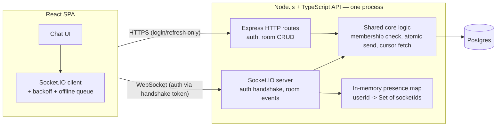

# Architecture — Chat App v2 (WebSockets)

## 1. Overview

v1 made a *pull-based* (polling) delivery model behave like a reliable
one. v2 replaces the transport with a *push-based* one (Socket.IO) and
asks a harder question: can you keep every one of v1's correctness
guarantees — no dropped messages, no duplicates, no out-of-order
rendering — once the network can fail in the middle of an open
connection, not just between discrete requests?

That reframe matters more than the features themselves. A typing
indicator is easy. A reconnect strategy that never loses a message and
never double-delivers one — while also detecting a half-dead connection
the OS hasn't noticed yet — is what separates "I added Socket.IO" from
"I understand what a persistent connection actually costs you."

**What's preserved from v1, unchanged:** the Postgres schema, the atomic
per-room sequence-number generator, the two `UNIQUE` constraints that
make duplicates structurally impossible, room-membership authorization,
and the entire JWT auth system (access token + rotating refresh token
with reuse detection). v2 does not touch any of that — it reuses it.
The socket layer is a new *transport* on top of the same *core*, not a
parallel system. Wherever possible, a socket event handler is a thin
wrapper that calls the exact same repository function an HTTP route
already calls.

**What's new:** Socket.IO server mounted alongside the existing Express
app, live typing indicators, online/offline presence, reconnection with
exponential backoff, a client-side offline message queue with
guaranteed-once-delivered replay, heartbeat-based dead-connection
detection, and a reconnect catch-up flow that closes the exact gap v1's
polling used to close on its own.

## 2. System Diagram



Socket.IO shares the same HTTP server and port as Express
(`new Server(httpServer)`, not a second listener) — one process, one
deploy, no new infrastructure. `/auth/*` (login, register, refresh) stays
plain HTTP, because refresh tokens live in an `httpOnly` cookie that only
makes sense in a request/response model. Everything room- and
message-related moves to the socket.

## 3. What Changes vs. v1, Explicitly

| Concern | v1 | v2 |
|---|---|---|
| Message delivery | Client polls `GET /rooms/:id/messages` on an interval | Server pushes `new_message` the instant it's written |
| Missed-message recovery | Every poll re-asks "anything after my cursor?" | Explicit catch-up step on reconnect only (§7) — no periodic re-ask |
| Auth | JWT verified per HTTP request via middleware | JWT verified once at handshake, then re-verified on token expiry mid-connection (§4) |
| Rate limiting | Per-request middleware, before the route handler | Per-socket-event handler, no middleware chain to hook into (§10) |
| Presence / typing | Explicitly a v1 non-goal | Core v2 feature (§8, §9) |
| Horizontal scaling | Assumed single instance | Still assumed single instance — see §12 for what changes if that stops being true |

The message-send **core logic itself** — membership check, row-locked
sequence increment, idempotent insert — does not change at all. It moves
from being called by an Express route handler to being called by a
Socket.IO event handler. Same function, different caller.

## 4. Connection Lifecycle & Auth

**Handshake.** The client connects with its in-memory access token:

```ts
io("wss://api.example.com", { auth: { token: accessToken } });
```

A Socket.IO middleware verifies it before the connection is accepted:

```ts
io.use((socket, next) => {
  try {
    const payload = verifyAccessToken(socket.handshake.auth.token);
    socket.data.userId = payload.sub;
    next();
  } catch {
    next(new Error("unauthorized")); // rejects the handshake outright
  }
});
```

Rejecting at the handshake means an unauthenticated client never gets a
`socket.id`, never enters any room, never touches presence — there's no
window where an unauthenticated socket exists in a half-initialized
state.

**Token expiry mid-connection.** The access token is deliberately
short-lived (15 min, per v1). A socket can live for hours. Two options
exist: force a full reconnect on every token refresh, or reauthenticate
the *same* socket in place. v2 does the latter, because forcing a
reconnect on a healthy connection just to rotate a token is wasted work
and a needless gap in delivery:

1. Server sets a per-socket timer for `exp - 60s`.
2. When it fires, emit `token_expiring` to that socket.
3. Client calls the existing HTTP `/auth/refresh` (cookie-based, exactly
   as in v1) to get a new access token, then emits
   `reauth: { token: newAccessToken }` **on the same socket** — no
   disconnect involved.
4. Server re-verifies, resets the timer.
5. If the client never reauths and the token actually expires, the
   server force-disconnects with a specific reason
   (`disconnect_reason: "token_expired"`) so the client's reconnect logic
   knows to refresh *before* attempting to reconnect, rather than
   retrying with a token that will just be rejected again.

**Implementation note (Phase 15):** the five steps above shipped as
`realtime/reauth.socket.ts` (server) and `client/src/realtime/connectionLifecycle.ts`
(client). What building them added:

- **`exp` comes from the token, not from a config constant.** The
  handshake middleware records `payload.exp * 1000` on `socket.data`, and
  `verifyAccessToken` now returns it (rejecting any token without a numeric
  `exp`). The warning fires at `exp - min(TOKEN_EXPIRY_WARNING_LEAD_MS,
  remaining / 2)` — the midpoint floor exists because a token shorter than
  the lead would otherwise be "already expiring" the moment it's issued, and
  the client would refresh in a loop.
- **`reauth` is acked** with `{ ok, expiresInMs }` or `{ ok: false, code }`.
  A bad or expired token answers `UNAUTHORIZED` and leaves the socket (and
  its timers) alone — a garbage reauth must not become a way to kick
  yourself. A *valid token for a different user* answers `FORBIDDEN` and
  closes the socket: without that check, `reauth` is an identity-swap
  primitive, because everything downstream trusts `socket.data.userId`.
- **No database in this path.** The refresh endpoint is already the gate on
  "does this session still exist," so a revoked session can ride its current
  access token to its natural expiry and no further — revocation latency is
  bounded by one access-token TTL, the same bound every HTTP request already
  lives with.
- **The client needs three recovery paths, not one**, because Socket.IO
  does *not* auto-retry a server-initiated disconnect (`io server
  disconnect`) or a middleware rejection (`connect_error`): (1)
  `token_expiring` → refresh → `reauth` in place (the happy path); (2)
  `disconnect_reason: token_expired` + `io server disconnect` → refresh,
  *then* `socket.connect()`; (3) `connect_error: UNAUTHORIZED` (e.g. a laptop
  woke up past its token's lifetime) → refresh → `socket.connect()`,
  capped at 3 consecutive tries so a refresh that "works" but yields a
  still-rejected token cannot loop. If the in-place swap itself fails, the
  client falls back to a clean disconnect/connect; Phase 12's catch-up
  covers the gap.
- **Cross-tab race (closed in the Phase 15 exercises).** The refresh token
  rotates, so two tabs refreshing at the same instant look like reuse and
  revoke the whole family. In-tab single-flight (v1) doesn't help across
  tabs. A 0–1.5s random delay before refreshing made a collision unlikely;
  `api/client.ts` now also wraps the refresh in a Web Lock
  (`navigator.locks`), so the second tab's request only leaves after the
  first has rotated the cookie. `crossTabRefresh.test.ts` runs the real
  module as two tabs against a rotating-token fake server: without the lock
  the loser is told `dead` and the family is revoked; with it both succeed.

`scripts/reauth-test.mjs` runs the *real* client module against a server
started with `ACCESS_TOKEN_TTL=6s TOKEN_EXPIRY_WARNING_LEAD_MS=3000`:
two clients stay connected ~17s (nearly three token lifetimes) with the
same socket ids, zero disconnects, six reauth round trips, and 26 of 26
messages delivered live with contiguous sequence numbers that equal what
the database holds. A control client that ignores `token_expiring` is
warned ~2.5s before `exp` and force-disconnected at `exp` — the proof that
the first result is the reauth working, not expiry being unenforced. It also
covers the identity swap, the garbage token, and the expired-token
handshake. (Writing it surfaced one gap, since closed: `refreshAccessToken` returned
`false` for *any* non-2xx, so a transient 5xx on refresh was treated like a
dead session — and cleared a perfectly good access token. It now returns
`ok` / `dead` / `transient`; only 401/403 is `dead`, and a `transient`
failure is retried with jittered exponential backoff for as long as the
token has time left — the `token_expiring` payload's `expiresInMs` is the
retry budget, not a fixed count. `reauth-transient-test.mjs` injects one
failure: the three-way client keeps the same socket, the boolean control is
force-closed at expiry and has to reconnect.) A `FORBIDDEN` reauth ack —
another tab signed in as a different user and the shared cookie now mints
*their* tokens — is reported through `onIdentityChanged` and deliberately
**not** reconnected: reopening the socket would silently continue as the
other user under the first user's UI.

**Joining a room.** `join_room: { roomId }` → server runs the *same*
membership check v1's `requireRoomMembership` does (refactored into a
plain function called from both the Express middleware and this socket
handler) → `socket.join(roomId)` on success, or an `error` event
(`FORBIDDEN` / `NOT_FOUND`, same codes as v1's HTTP error shape) on
failure. A client is never silently in a room it shouldn't be in.

## 5. Real-Time Message Flow

```
client                          server                         other clients in room
  |--- send_message {roomId, clientMessageId, body} --->|
  |                                                       |-- same atomic sequence
  |                                                       |   + idempotent insert
  |                                                       |   as v1's HTTP route --|
  |<---------- message_ack {clientMessageId, seq} -------|
  |                                                       |--- new_message ------->|
```

The server handler is literally:

```ts
socket.on("send_message", async ({ roomId, clientMessageId, body }, ack) => {
  await requireMembership(socket.data.userId, roomId);          // same check as v1
  const message = await insertMessage({ roomId, senderId: socket.data.userId, clientMessageId, body }); // same repo fn as v1
  ack({ clientMessageId, sequenceNumber: message.sequenceNumber });
  socket.to(roomId).emit("new_message", message);
});
```

`insertMessage` is the exact function from v1's Phase 4 — same
`ON CONFLICT (room_id, client_message_id) DO NOTHING` idempotency, same
row-locked sequence counter. This is deliberate: a duplicate `send_message`
(from the offline-queue replay in §6) is exactly as safe here as a
duplicate HTTP POST was in v1, for exactly the same database-level
reason.

The client only removes a message from its pending/offline queue when
`message_ack` names its `clientMessageId`. No ack yet → still pending →
still eligible for replay. This is what makes "at least once, exactly
displayed once" true: **delivery** can be retried freely because
**persistence** is idempotent; the ack just tells the client it can stop
retrying.

### Membership is a cached "yes" — revocation must reach live sockets

*(Added in Phase 16, after the integration suite found it missing.)*

v1 asked "is this user still a member?" on every request, so leaving a room
cut access on the very next poll. In v2 the question is asked **once**, at
`join_room`; after that every push to `room:7` is a cached "yes" held in
Socket.IO's room table. An HTTP `POST /rooms/7/leave` deleted the database row
but nothing touched that table, so the ex-member kept receiving the room's
messages, typing and presence until they happened to reconnect. Reproduced
before the fix: Bob leaves, Alice sends "secret after bob left", Bob's socket
receives it.

The fix has four parts, each closing a different hole:

1. **Announce, don't import.** The leave route calls
   `announceMembershipRevoked({ roomId, userId })` on a tiny in-process bus
   (`realtime/membershipEvents.ts`); the socket layer subscribes. Dependencies
   point inward (routes → bus ← sockets): the REST layer never imports a
   transport.
2. **Address a person, not a connection.** Every socket joins a personal room
   `user:<id>` on connect. On revocation the server does
   `io.in("user:<id>").socketsLeave("room:<roomId>")` — evicting *every* tab and
   device at once without enumerating them — and tells them
   (`removed_from_room`) so the UI can say why instead of going silently dead.
3. **Re-check after the join.** `join_room` checks membership and then joins,
   with awaits in between. A leave that lands in that gap runs its eviction
   before the socket is in the room, so the eviction finds nothing to remove
   and the join then succeeds: a zombie member with no database row. The
   handler therefore verifies membership *again* after `socket.join` and backs
   out if it's gone. Either the eviction sees the socket or the re-check sees
   the missing row — there is no third case. (Joins are rare; one extra query
   is cheap insurance on an authorization boundary.)
4. **Reconcile, don't only announce.** The announce is an *edge*: it fires
   once, and if it is lost — an exception between the `DELETE` and the
   announce, or an instance dying in that window while *another* instance holds
   the user's socket — nothing ever repeats it. `realtime/membershipSweep.ts`
   is the level-triggered backstop (the shape of a Kubernetes controller: keep
   asking "does reality match the database?" rather than trusting that you saw
   every event). Every `MEMBERSHIP_SWEEP_INTERVAL_MS` (default 30s; `0`
   disables) it takes the live `(room, user)` pairs from `io.fetchSockets()`,
   anti-joins them against `room_members` in **one** query for the whole server
   (measured: 5 queries in a 1.05s window with 5 live rooms and a 200ms
   interval, nothing else touching the database), and evicts any pair with no
   row — logging a `warn` each time, because a hit means the fast path
   *failed* (that line is the alert; the sweep is the safety net, not the
   plan). With the announce deliberately swallowed
   (`realtime.membership.sweep`), the ex-member heard **every** message
   forever without the sweep, and was evicted about 315 ms after leaving with a
   200 ms interval. A *single* instance that dies needs no sweep: its sockets
   die with it, and `join_room` re-checks the database when clients reconnect.

The general lesson: any time a permission is checked once and then cached in a
long-lived structure, ask what *invalidates* the cache. The check is the easy
half.

## 6. Reconnection: Backoff + Offline Message Queue

**Why exponential backoff, not fixed-interval retry.** If a server
restarts (a deploy, a crash) and every connected client retries at the
same fixed interval, they all hit the server in the same instant it
comes back up — a self-inflicted thundering herd, at the exact moment
the server is least ready for load. Exponential backoff spreads retries
out over time; adding *jitter* (randomizing each client's delay slightly)
spreads them out across clients too, so the herd never forms in the
first place.

```ts
// client/src/realtime/socket.ts
io(API_BASE, {
  auth: (cb) => cb({ token: getAccessToken() }),
  reconnection: true,
  reconnectionDelay: 1000,        // first retry after ~1s
  reconnectionDelayMax: 30000,    // never wait longer than 30s between attempts
  randomizationFactor: 0.5,       // +/-50% jitter on every delay
  reconnectionAttempts: Infinity, // keep trying — a chat app shouldn't give up
});
```

Socket.IO implements the mechanics; understanding *why* these specific
numbers (and not, say, a flat 5s retry) is the actual skill being
demonstrated.

**Offline message queue — an outbox, not a retry wrapper.** Rather than
"try to emit, and queue only if that fails," `sendChatMessage` always
enqueues first, then asks the queue to flush (a no-op if disconnected,
immediate if not). This unifies two cases that would otherwise need
separate handling: a message composed while genuinely offline, and a
message that WAS emitted but whose `message_ack` never arrived before
the connection dropped ("in flight at the moment of disconnect"). Both
just mean "still sitting in the queue," and the exact same flush path —
triggered on send, and again on every `connect`/reconnect — covers both:

```ts
// client/src/realtime/outbox.ts
export interface QueuedMessage {
  roomId: number;
  clientMessageId: string;
  body: string;
  queuedAt: string;
}
```

The queue lives in a module with **zero dependency on the socket
module** — `flushQueueOverSocket(socket)` takes the socket as a
parameter rather than importing `connectSocket`/`getSocket` itself. It's
`socket.ts` that owns the wiring, attaching the queue's flush function to
`connect`, and removing an entry the moment its `message_ack` (or a
definitive `error` naming its `clientMessageId`) arrives — registered
once, at socket-creation time, independent of whichever room UI happens
to be mounted, since message durability is a property of the connection,
not of a particular page.

`flushQueueOverSocket` deliberately does **not** track "already emitted,
awaiting ack" as a separate state from "never attempted" — every call
just re-emits everything still in the queue, unconditionally, including
an item a previous flush already sent moments ago. That's not an
oversight; it's leaning on the exact guarantee the previous phases
built: the server's `(room_id, sender_id, client_message_id)` unique
constraint (Phase 4) makes any number of duplicate `send_message` emits
for the same `clientMessageId` collapse to exactly one row, each one
getting back the same `message_ack`. Client-side "don't resend what
might already be in flight" bookkeeping would be complexity in service
of avoiding a redundant round trip, not in service of correctness —
correctness already comes from the database, for free. Persistence to
`localStorage` (loaded once at module init, written on every enqueue/
dequeue) is what makes a queued message survive a full page reload while
offline, not just an in-memory disconnect.

**The optimistic UI has three states, not two, driven entirely by
events — no timeout anywhere.** Phase 10 shipped a client-side timeout as
an honest stopgap: nothing else would ever revisit a bubble stuck on
"Sending…" if its ack never arrived. Phase 11 replaces that guess with
real event-driven transitions: `queued` (sitting in the outbox, nothing
to flush to right now) → `pending` (flushed to a live connection,
awaiting `message_ack`) → either confirmed (an incoming `message_ack`
replaces the bubble via `mergeMessages`, same as Phase 10) or `failed`
(a definitive, non-retryable error named this `clientMessageId`). A
`disconnect` while a message is `pending` moves it back to `queued`
(the outbox already holds it regardless; this only corrects what the UI
shows), and the next `connect` moves any of that room's `queued` bubbles
back to `pending` as the flush fires. Nothing here needed a single change
to server code — Phase 4's idempotency guarantee was already strong
enough to make Phase 11 a client-only phase.

## 7. Missed-Message Catch-Up on Reconnect

This is the single most important carryover from v1, restated for a
push model: **the standing project requirement is sequence numbers so a
client can detect and refetch anything it missed — v2 has to satisfy
that over a socket, not just over HTTP.** A live `new_message` push only
reaches a client that's connected *at the moment* a message is sent. Any
message sent while a client was disconnected needs a separate recovery
path, or v2 is strictly worse than v1 at the one thing v1 was built to
guarantee.

On every successful `join_room` (including the very first join and every
rejoin after a reconnect), the client includes the highest
`sequence_number` it has locally cached for that room:

```ts
socket.emit("join_room", { roomId, sinceSequence: 482 });
```

The server runs **the same cursor query v1's poll route already uses**
(`sequence_number > $sinceSequence`, ordered ascending, paginated by the
same `limit`/`has_more` convention) and emits the result as a `catch_up`
batch. The order of operations inside `join_room` is the whole subtlety:

```
1. client rejoins, sends sinceSequence: 482
2. server: membership check
3. server socket.join(room)                 <- live delivery starts HERE
4. server: SELECT ... WHERE sequence_number > 482 ORDER BY sequence_number LIMIT 51
5. server emits catch_up: { messages: [...], hasMore, latestSequenceNumber }
6. server emits joined_room
```

**Join first, query second — and this is a correction.** The Phase 12
implementation did it the other way round (query, emit, *then* join), on the
reasoning that joining first lets a message arrive twice, once live and once
inside the batch. Phase 16's seam test falsified the premise: the two failure
modes are not symmetric.

| Order | A message committed in the gap | Result |
|---|---|---|
| query, then join | after the query's snapshot, before the join | in **neither** the batch nor the live stream — silently lost |
| join, then query | any time after the join | pushed live, and/or included in the batch (the query runs after the join) — at worst **twice** |

A duplicate is invisible: every client dedupes by `client_message_id`
(`mergeMessages`). A gap is silent data loss that nothing ever repairs,
because the client has no reason to look. The window is a few milliseconds
wide in production, which is exactly why it survived: it needs a message to
land in it, and no happy-path demo ever has. The regression test
(`realtime.catchup.test.ts`, "a message committed BETWEEN the catch-up query
and the join") opens that window deterministically by letting the real query
run and then sending a message *before* its result is handed back; against
the old order Bob's view is `[1, 2, 3]` and message `4` is missing.

The consequence of joining first is that a live `new_message` can now arrive
**before** the `catch_up` batch it overlaps. That is harmless to display
(sorted merge, deduped), but it is not harmless to the *cursor*, which is the
second half of the correction.

### The client cursor (`client/src/realtime/catchUpCursor.ts`)

"The highest `sequence_number` I have seen" is the obvious value to send as
`sinceSequence`, and it is wrong the moment anything arrives out of order. The
invariant the client actually needs is stronger:

> every message with `sequence_number <= cursor` is already known.

So the cursor is a **contiguity watermark**, and only two kinds of input may
move it:

- a **`catch_up` page** may *jump* it. The server's `SELECT … WHERE
  sequence_number > since ORDER BY … LIMIT` is an authoritative statement about
  the whole range `(since, latest]`, so advancing to `latestSequenceNumber` is
  always valid;
- a **live push** (or the ack of our own send) moves it only if it is exactly
  `cursor + 1`, or completes a run that was waiting. Anything further ahead
  waits in an `ahead` set - the message is still *shown*; `ahead` only decides
  what the cursor may *claim* - and is released when the hole below it fills in
  or a page covers it. A disconnect clears `ahead` (the reconnect's catch-up
  refetches everything above the cursor anyway).

Two earlier designs fell short, and the second is instructive. Phase 12 used
"highest seen". Phase 16 first fixed that with a guard - live pushes do not
move the cursor while a catch-up is in flight - which closes the race between a
live push and a *multi-page catch-up* and passed every test written for it. It
does not close the race between live pushes **themselves**: sequence numbers
are assigned in commit order (the counter row's lock is held until commit), but
the broadcast happens when the sender's handler resumes, and two handlers can
resume in the opposite order. A client can be told `2` before `1`. Jump to `2`,
lose the connection before `1`'s push lands, and the reconnect asks for
"everything above 2": message `1` is gone for good. This was reproduced
deterministically (`realtime.catchup.ordering`: a gate on the first
`sendMessage` holds it between commit and broadcast) and found independently by
the model-based test (`catchUpCursor.model.test.ts`: seeded random interleavings
of appends, drops, pages and swapped pushes, with the invariant checked after
**every** step - about a third of seeds break the old cursor, the shortest
counterexample is seven steps). The watermark removes the class rather than
patching the instance: there is no "unsafe input" left to guard against,
because nothing but an authoritative page can move the cursor past a hole.

Two things this deliberately did *not* need. **Stopping the sequence burn**
(Phase 4: a duplicate retry commits its claimed number without using it) - the
bug reproduces with no duplicates at all. A burned number does leave a permanent
hole, and the watermark's answer is the conservative one: it stalls below it and
the next `catch_up` (any reconnect) steps over it, at the price of re-fetching
messages the client already has (deduped by `client_message_id`).
`cursor.hasGap` exposes "a live message is waiting above a hole" for a page that
wants to schedule a repair `join_room` sooner. **A refetch overlap** (`since =
cursor - K`) is cheaper but is a guess about how far messages can be reordered;
the watermark has no magic number. (If you do want gap-free numbers: the
duplicate path ending in `ROLLBACK` instead of `COMMIT` gives them - checked
against a real Postgres with 30 distinct ids and 30 concurrent duplicate
retries, `COMMIT` leaves 30 holes and `ROLLBACK` leaves none. It reverses a
documented Phase 4 trade-off, so it is not done here.)

This is a dependency-free class (`CatchUpCursor`) precisely because it is the
one piece of client logic whose bugs lose messages silently. It is unit-tested
directly, and the server integration suite drives the *shipped* class against
the real server (`RoomFollower` in the test harness), so the two halves of the
protocol are tested together rather than each against the other's imagined
behaviour.

If `has_more` comes back true (the client was offline long enough that
more than one page of history piled up), the client immediately requests
the next page with the same mechanism, exactly as v1's poll route did —
catching up in a couple of round trips instead of ever silently dropping
messages older than the last page fetched. (From the previous page's end —
see the cursor rules above.)

**Implementation note (Phase 12):** "the same mechanism" turned out to
mean, literally, re-emitting `join_room` itself — not a second dedicated
event. `socket.join()` on a room this socket already belongs to is a
harmless no-op (Socket.IO's own join bookkeeping is a `Set` under the
hood), so a follow-up page request for a large gap and a brand-new join
are indistinguishable to the server: both just run the catch-up query
against whatever `sinceSequence` was sent and emit a `catch_up` batch. One
event, one code path, instead of a second event that would have to
duplicate the membership check and the join-ordering guarantee.

Client-side, `ChatRoomPage.tsx` holds a `CatchUpCursor` in a ref (not
state — it is read inside socket event-handler closures and needs its value
at call time, and changing it must never trigger a render). It is seeded from
the initial HTTP page's `latest_sequence_number`, so the same `beginJoin()`
value flows into `join_room` whether this is the first join, a reconnect
after a network drop, or a follow-up page.

**Known limits (deliberate, documented, not hidden).**

- *A hole that never fills.* A sequence number burned by a duplicate retry
  stalls the watermark until the next `catch_up` (above). Correctness is never
  affected - the stall is in the safe direction - but a long session after a
  burn re-fetches (and dedupes) some messages on its next reconnect.
- *A throw after the join.* If the catch-up query fails after `socket.join`,
  the client receives an `error` and has live delivery but no batch; the next
  reconnect repairs it. That is preferable to the reverse (a batch, but no
  live stream).

## 8. Heartbeat & Dead-Connection Detection

A TCP connection can outlive the network path that was carrying it — a
laptop closing its lid without sending a FIN, a NAT or corporate
firewall silently dropping an idle connection without an RST, a mobile
device switching cell towers. The OS on either end may not notice for
minutes. Waiting for the OS is not an option for presence or for
freeing up server-side resources promptly.

Socket.IO's engine.io layer solves this at the application level: the
server pings, the client must pong within a timeout, or the connection
is torn down from the server's side regardless of what the OS still
thinks is happening:

```ts
new Server(httpServer, {
  pingInterval: 25000, // server pings every 25s
  pingTimeout: 20000,  // no pong within 20s of a ping -> treat as dead
});
```

A heartbeat-detected death runs through the **exact same** cleanup path
as an explicit `disconnect` event (decrement presence, notify rooms) —
there is deliberately no special case for "dead vs. explicitly closed."
The only difference is *what triggered* the cleanup, never what the
cleanup does.

## 9. Presence (Online / Offline)

Presence is not "is a socket connected" — a user can have the app open
in two tabs, or on a phone and a laptop at once. Naive boolean presence
flickers to "offline" the instant *any one* of those closes. v2 uses
reference counting, keyed by user, in an in-memory map on the server:

```ts
const presence = new Map<UserId, Set<SocketId>>();
```

- **Connect** (after successful auth): add `socket.id` to the user's
  set. If the set went from empty to non-empty, broadcast
  `presence: { userId, status: "online" }` to every room that user is a
  member of.
- **Disconnect** (explicit or heartbeat-timeout, §8): remove
  `socket.id`. If the set is now empty, **don't broadcast offline
  immediately** — start a short grace timer (5–10s). If the same user
  reconnects before it fires, cancel the timer; nothing was ever
  broadcast. If it fires, broadcast `presence: offline`.

The grace period exists because a page refresh is a disconnect
immediately followed by a reconnect — without it, every refresh would
flash a user's status to everyone in their rooms for no reason. This is
the kind of detail that's invisible in a demo recorded on a good network
and immediately obvious the first time someone refreshes on a flaky one.

This map is per-process, which is consistent with the single-instance
assumption carried over from v1 (see §12 for what changes if that stops
holding).

**Implementation note (Phase 13):** `markOnline`/`markOffline` (both in
`realtime/presence.ts`) are called from the connection handler and the
`disconnect` handler in `realtime/socket.ts`, both fire-and-forget with a
`.catch` — same posture as Phase 10/11's `usernameReady`, for the same
reason: presence is best-effort, and an unawaited promise with no
rejection handler is exactly the class of bug that crashed the whole
process in Phase 11 (see §15). `markOnline` is deliberately chained onto
`usernameReady` (`usernameReady.then(() => markOnline(...))`) rather than
fired independently in the same tick — two unrelated DB reads landing at
the literal same instant on a connection that's otherwise idle right then
have no reason to race each other for a pool slot, and sequencing them
costs a fraction of a millisecond while reducing DB contention right when
it's most likely to spike (many reconnects landing at once after a
restart). `broadcastPresence` reuses `listRoomsForUser` (already built for
the HTTP `GET /rooms` list) exactly as-is — no new query.

`pingInterval`/`pingTimeout` (§8) and the presence grace period are read
from `env.ts`, overridable via `SOCKET_PING_INTERVAL_MS`,
`SOCKET_PING_TIMEOUT_MS`, and `PRESENCE_GRACE_PERIOD_MS` — production
keeps the documented 25s/20s/7s defaults; only a verification run
overrides them, because proving "a dead connection is detected via
heartbeat, not left hanging" for real means actually waiting out a
timeout, and 25s+20s per check makes for a slow test suite. The
verification script (`scripts/presence-test.mjs`) simulates a connection
that goes dark without a clean close — the actual scenario §8 describes,
not just a `socket.close()` — by pausing the raw WebSocket's underlying
Node socket (`clientSocket.io.engine.transport.ws.pause()`) right after
connecting: no close frame is ever sent, so only the server's own
ping/pong timer ever notices anything is wrong.

## 10. Typing Indicators

Typing events are ephemeral, high-frequency, and must never touch
Postgres or go through the durable message pipeline — persisting them
would mean a burst of keystrokes turns into a burst of writes for
information that's meaningless five seconds later.

- **Client**: throttles `typing_start` to at most once per ~2s while
  actively typing, and explicitly emits `typing_stop` on blur, on send,
  or after ~3s of no further keystrokes.
- **Server**: pure relay, no persistence —
  `socket.to(roomId).emit("typing", { userId, roomId })` /
  `"stopped_typing"`. No database access in this path at all.
- **Receiving client safety net**: auto-clears a given user's "typing"
  indicator if no further `typing_start` arrives within ~5s, independent
  of ever receiving `typing_stop`. A client that crashes or loses its
  connection mid-keystroke, without emitting `typing_stop`, should never
  leave a permanently stuck "X is typing…" on everyone else's screen —
  the receiver's own timeout is the thing that guarantees this, not
  trusting the sender to always clean up after itself.

**Implementation note (Phase 14):** `typing.socket.ts` is deliberately the
thinnest handler file in the project — no repo import, no pool import, not
even `checkRoomMembership` — but "no database access" doesn't mean "no
authorization check." `socket.to(roomName)` broadcasts to an arbitrary
room-name string regardless of whether the *sending* socket itself ever
joined that room, so a connected-but-unrelated client who simply knows (or
guesses) another room's numeric id could otherwise spoof a typing
indicator into a room they were never authorized to know exists. The fix
costs nothing extra: `socket.rooms` is Socket.IO's own in-memory `Set` of
rooms this socket has actually `join()`-ed, already populated by
`join_room`'s real, DB-backed membership check earlier in the connection's
life. Checking `socket.rooms.has(roomKey(roomId))` is a plain in-memory
lookup — zero added DB cost — while still closing the spoofing gap, since
only a socket that already passed `join_room`'s check can be in that Set.
There is deliberately no `disconnect`-triggered cleanup emitting a
synthetic `stopped_typing` — that responsibility sits entirely with the
receiving client's own auto-clear timeout described above, which already
has to handle "sender vanished without warning" unconditionally; a second,
server-side mechanism attempting the same cleanup couldn't distinguish a
genuine crash from a network blip about to recover, for a feature where
being briefly wrong costs nothing.

The receiving-client auto-clear timer itself was pulled out of
`ChatRoomPage.tsx` into its own framework-free module
(`client/src/realtime/typingTracker.ts`), the same move Phase 11 made for
the outbox — this logic is pure bookkeeping around timers and a `Set` with
nothing React-specific about it, and leaving it as inline closures inside
a `useEffect` would mean the only way to test the actual DoD (the
auto-clear guarantee) is driving a fully mounted component through fake
timers. The extracted module is driven directly and deterministically in
`typingTracker.test.ts` (9 cases, `vi.useFakeTimers()`), including the
one that matters most: a user who never sends `stopped_typing` still
clears after the timeout, and a sustained typing burst keeps resetting
the clock instead of flickering off mid-sentence.

`scripts/typing-test.mjs` proves the server-observable half of the
contract — relay correctness, the authorization gate rejecting a
never-joined socket with `FORBIDDEN`, and a burst of `typing_start`/
`typing_stop` leaving the room's message count and latest sequence number
completely unchanged, checked through the same public
`GET /rooms/:roomId/messages` endpoint a real client's scrollback would
use rather than a second direct database connection — this sandbox's
PGlite stand-in tolerates a second simultaneous raw connection poorly
(reproduced independently with `concurrency-test.mjs`), never a real
Postgres behavior, and proving the claim through the public API surface
is a strictly black-box-stronger check anyway.

## 11. Rate Limiting on the Socket Layer

v1's token-bucket limiter (Phase 7) is per-user, in-process, and was
applied as Express middleware — but there's no middleware chain for
socket events, so it has to be invoked explicitly inside each handler
instead of wrapping it implicitly:

```ts
socket.on("send_message", async (payload, ack) => {
  if (!sendBucket.tryConsume(socket.data.userId)) {
    return socket.emit("rate_limited", { event: "send_message", retryAfterSeconds: sendBucket.secondsUntilNextToken(socket.data.userId) });
  }
  // ... proceed
});
```

`typing_start` needs its own (cheap, generous) bucket too — arguably a
*more* important one than message send. A message send is already
naturally rate-limited by human typing speed; a buggy or malicious
client emitting `typing_start` on every keystroke with no client-side
throttle has no such natural ceiling, and it fans out to an entire
room's worth of sockets on every emit, making it the cheaper flood
vector of the two.

On exhaustion the socket is **never disconnected** — a rate limit is a
"slow down," not a "get out." Disconnecting a persistent connection over
a transient burst is far more disruptive than rejecting one HTTP request
was in v1, since it now costs a full reconnect-and-catch-up cycle to
recover instead of just the next request succeeding.

**Implementation note (Phase 15):** the sketch above is the shape; four
things changed building it.

- **One store per limited thing, shared across transports.** The v1
  limiter owned its own buckets inside Express middleware, so a socket
  handler could not spend from them. `rateLimit/bucketStore.ts` now owns
  the buckets (`consume(userId)` → allowed, or refused with
  `retryAfterSeconds`), `rateLimit/limits.ts` declares `sendMessageStore`,
  `pollMessagesStore` and `typingStore` as process-wide singletons, and
  both the HTTP route and the socket handler spend from the same
  `sendMessageStore`. Separate budgets per transport would hand a client
  double the rate by alternating between them. Full buckets are swept
  opportunistically inside `consume()` — no timer to leak, nothing to
  unref. (Precisely: the sweep runs inside `consume()`, so memory is bounded
  by users active within the last sweep interval — but if traffic stops
  entirely nothing runs, and the map keeps its last size until the next
  request from anyone. Bounded, not zero; proved in `rateLimit.exercises.test.ts`.)
- **The limiter runs first in the handler**, before validation and the
  membership check (`socketRateLimit.ts`). A refused event should cost
  almost nothing, and if invalid payloads got an `error` reply for free, a
  flood of garbage would turn the server into an amplifier.
- **The notices are themselves throttled.** Answering a 1,000-events/sec
  flood with 1,000 `rate_limited` events would make the limiter amplify the
  very flood it exists to stop. Each (socket, event) pair gets at most one
  notice per `retryAfterSeconds`, which is also how long the client was told
  to wait, so a well-behaved client never needs a second. The same throttle
  bounds the `warn` log line. This supersedes Phase 14's silent drop for
  typing — silence protected against the same amplification, but the
  roadmap's contract is "an event to that socket," and throttling the
  notice delivers both. `typing_start` and `typing_stop` share one bucket
  (otherwise alternating between them doubles the rate) but track notices
  separately.
- **A refused `send_message` is not a failed one.** The notice describes
  the socket's *budget*, not any single message's fate, so it carries no
  `clientMessageId`. The message stays in the client's outbox; the client
  schedules one flush at `retryAfterSeconds` + 100ms. That is safe because
  sends are idempotent (Phase 4) — a retry that lands twice still creates one
  row. Typing notices are ignored client-side; a dropped indicator is not
  worth retrying. The chat page shows "You're sending messages too quickly.
  Retrying automatically in Ns…".

Keyed by `userId`, never `socket.id` — a per-connection budget gives every
extra tab its own free allowance. `scripts/ratelimit-test.mjs` floods 200
`send_message` and 200 `typing_start` events from one user while a second
user in the same room keeps working: one `rate_limited` notice per flood,
the flooder's socket keeps the *same* socket id (a silent reconnect would
change it), 10–11 of 200 sends persisted, about a dozen replies in total (acks included),
the other user's five sends all acked and delivered, ~10 typing events
relayed, and the flooder can send again after the window. (The existing
`catchup-test.mjs` broke on first run — it sends 55 messages back-to-back
from one socket — and was changed to behave like the real outbox: wait the
advertised delay, resend the same `clientMessageId`.) The limiter's
behavior is also pinned deterministically, with fake timers, in
`bucketStore.test.ts` and `socketRateLimit.test.ts`.

*Still single-process:* the buckets live in this process's memory, so with
N instances a user's real limit is N× the configured one. Deferred along
with the rest of horizontal scaling (§12); a Redis-backed store is the
swap, and `BucketStore` is the seam.

## 12. Explicitly Deferred (and why)

- **Horizontal scaling (multiple server instances).** Presence and room
  broadcast both currently live in one process's memory. The moment
  there's more than one instance, a message from a client on instance A
  never reaches a client on instance B without a shared broadcast layer
  — the standard fix is the official `@socket.io/redis-adapter`, which
  uses Redis pub/sub so an emit on any instance reaches sockets connected
  to every instance. This project has deliberately avoided adding
  infrastructure it doesn't need yet (no ORM, no cache, hand-rolled rate
  limiter over a library) and the current deploy is a single Render
  instance — so v2 does not add Redis. This is a scoped decision, not an
  oversight: the moment a second instance is genuinely needed, this is
  the specific, well-documented gap to close first, before anything else
  breaks in more confusing ways.
- **Cross-instance membership eviction.** The revocation bus is an in-process
  `EventEmitter`, like presence and room fan-out. With a second instance behind
  the Redis adapter the *normal* path still works: `io.in(...).socketsLeave(...)`
  and `io.fetchSockets()` are adapter-aware (the Socket.IO docs: "they will work
  across Socket.IO servers"), so the instance that served `POST /leave` evicts
  the user's sockets wherever they are. What does not survive scaling out is a
  **lost** announce - that instance dying between the `DELETE` and the announce
  leaves every *other* instance's sockets holding a cached "yes". The
  reconciliation sweep (§5) is what bounds that, and because `fetchSockets()` is
  cluster-wide it covers every instance from any one of them (duplicate
  evictions are harmless). A shared announcement channel (a Redis channel, or
  Postgres `LISTEN/NOTIFY` on the membership table) would make the fast path
  cross-instance too, but it would still be an edge - the sweep stays as the
  backstop either way.
- **Load-balancing a second instance.** Engine.IO keeps each session (`sid`) in
  one process's memory, and a long-polling session - plus the polling →
  WebSocket upgrade - is several requests carrying that `sid`. Spread them
  across instances and the second lands on a process that never heard of it:
  `400 {"code":1,"message":"Session ID unknown"}` (reproduced in
  `realtime.multiinstance`: round-robin → `connect_error`; pinned → connects and
  upgrades). The three options in the Socket.IO docs: sticky sessions (cookie
  or IP hash at the balancer), disabling long-polling (`transports:
  ['websocket']` - no sticky routing needed, at the cost of clients behind
  networks that block WebSockets), or client-side balancing. Also: a proxy's
  read timeout (nginx `proxy_read_timeout` defaults to 60s) must exceed
  `pingInterval + pingTimeout` (here 25s + 20s = 45s), or it will cut idle
  connections with a `transport close`. A free Render web service is a single
  instance, so none of this can happen there today - which is exactly why it
  would first appear in production, not in testing.
- **Read receipts.** A natural v3 candidate (per-message "seen by" state,
  another place idempotency and ordering matter) but out of scope here to
  keep this phase focused on transport correctness, not feature breadth.
- **End-to-end encryption.** Out of scope for the same reason it was in
  v1 — this project is about delivery correctness, not confidentiality.

## 13. Testing Strategy for Realtime

*As built in Phase 16.* supertest (v1's tool) wraps Express without binding a
port — fine for HTTP, useless for sockets, where the connection **is** the
thing under test. v2's suite binds the real Express + Socket.IO stack to an
ephemeral port and drives it with `socket.io-client` as a genuine client,
against the same PGlite-backed database v1 built. `cd server && npm test`
runs all of it in one command (24 files, 107 tests, about a minute and a half;
`npm run test:fast` runs the same files in parallel in about half a minute —
see "Parallel files" below).

### The harness (`server/tests/helpers/realtimeHarness.ts`)

- **`startRealtimeServer({ env, port })`** builds a server from a *fresh module
  graph* (`vi.resetModules()` + dynamic import). `env.ts` reads `process.env`
  once at import time, and several modules hold process-wide state (the
  presence map, rate-limit buckets, the shutdown flag, the pg pool). A test
  that needs a 300ms presence grace period or a 4-second token must set those
  variables *before* the graph first loads, and must get pristine state so a
  spent bucket or a flipped shutdown flag cannot leak into the next server. A
  fresh graph per server is also what lets the shutdown test run an "old
  instance" and a "new instance" side by side in one process.
- **`TestClient`** wraps a `socket.io-client` socket and *records* every event.
  `take(event)` consumes the first match, whether it arrived before or after
  the call. (The classic flaky-realtime-test bug is registering a one-shot
  listener after the event already fired.) `collect(event, windowMs)` waits a
  bounded quiet window and returns what arrived — that is how a **negative**
  ("Bob receives nothing") is asserted without hoping.
- **`RoomFollower`** is the client half of the catch-up protocol, built on the
  *shipped* `CatchUpCursor`; the reauth and shutdown suites likewise attach the
  *shipped* `attachConnectionLifecycle` to the test socket. The tests therefore
  exercise the real client policy against the real server, not a test author's
  idea of either.
- **`startProxy()`** is a TCP proxy you can `blackhole()` (swallow bytes while
  keeping both sockets open — a silent network death, the only thing that
  proves *heartbeat* detection), `cutAll()` (a connection that vanishes with
  no notice), and `setTarget()` (retarget new connections — a platform router
  shifting traffic to a new instance mid-deploy).
  It also counts the bytes that crossed it (`proxy.bytes`), so a test can
  assert how much a server *says*, not just what: the typing-flood test measures
  the server's output to the flooder on the wire.
- **`deferred()`** is a promise resolved from the outside - a *gate*. Wrapping
  `server.repo.sendMessage` with `vi.spyOn(...).mockImplementationOnce` and a
  gate freezes a handler at an exact point (after the `INSERT` commits, before
  the ack/broadcast), which turns "sleep and hope the race lands" into a forced
  interleaving. Three suites use it (`replay.interleave`, `catchup.ordering`,
  and the earlier membership race).
- **`DB_POOL_MAX=1`** for the test pool. PGlite serves one connection at a time,
  and a realtime test inherently overlaps queries (a connection's username
  lookup, its presence lookup, the client's first `join_room`). A pool of one
  makes the pool serialize them instead of failing with "Connection terminated
  unexpectedly". Production keeps 10.

### What each suite proves

| File | Proves |
|---|---|
| `realtime.messaging` | handshake auth (no/garbage token refused, no server socket created); polling → WebSocket upgrade; ack to sender + push to others with the same row and consecutive sequences; non-members refused on join *and* send, and hear nothing; typing relayed, never echoed, refused for an unjoined room |
| `realtime.replay` | **reconnect-and-replay, exactly once.** A resent id returns the *original* row; a message cut mid-flight at 0/3/10/30 ms lands exactly once whichever side of the commit the cut fell on; five messages queued offline replay in order on reconnect, once each, even when the flush runs twice (a reconnect storm) |
| `realtime.catchup` | **catch-up correctness.** A 120-message gap arrives complete, ordered, in exactly three pages with no duplicates, then live delivery resumes; a dropped client receives exactly what it missed; **a message committed between the catch-up query and the join is not lost** (the seam, §7); live pushes interleaved with a multi-page catch-up never make the client skip a page; bad cursors → `VALIDATION_ERROR`; non-members get no batch; other rooms never leak |
| `realtime.catchup.ordering` | **out-of-order live pushes.** Alice's message commits as seq 1 but is broadcast late (a gate); Bob's seq 2 overtakes it; Carol — driving the shipped cursor — drops between the two and must still end with both on reconnect (`[2]` vs `[1,2]` against the old cursor) |
| `realtime.membership` | **revocation reaches live sockets.** After `POST /leave` the leaver receives no further messages/typing and can't speak into the room from a stale socket; *every* tab is evicted and only that user; their other rooms are untouched; rejoining restores delivery; and a join that **races** a leave (opened deterministically between the membership check and the join) does not leave a zombie member |
| `realtime.membership.sweep` | **bounded staleness when the revocation signal is lost.** With the announce swallowed: no sweep → the ex-member hears everything, forever, and only a reconnect (refused by `join_room`) ends it; a 200 ms sweep → evicted ~315 ms after leaving and silent afterwards; cost → one query per tick for the whole server, none per room or per push |
| `realtime.presence` | **reference counting.** Two sockets, one user: online once; closing one changes nothing; closing the last goes offline only after the grace period. A reconnect inside the grace period broadcasts *nothing*. A silently dead connection (proxy blackhole) is detected by heartbeat (`ping timeout`) and then goes offline. Presence reaches only people sharing a room |
| `realtime.ratelimit` | a flood gets **one** `rate_limited` notice, the connection survives, refused sends never reach the database, and the advertised `retryAfterSeconds` is honest; the budget belongs to the *user* (a second tab gets no fresh allowance); HTTP and socket spend from one send budget |
| `realtime.typing.flood` | 5,000 `typing_start` in ~2 s: ~14 accepted (burst 10 + 2/s refill), ≤ a few `rate_limited` notices, the connection survives, and the server sends the flooder back a few hundred bytes for ~185 KB received (measured on the wire). A notice on *every* refused event would be 4,987 notices / 334 KB — the server out-talking the attacker |
| `realtime.reauth` | the real client lifecycle refreshes and reauths **on the same socket**, outlives its original token and re-arms for the next one (one connect event, ever); a client that ignores the warning is disconnected at expiry and cannot return with that token; a reauth with another user's token → `FORBIDDEN` and drop; garbage → `UNAUTHORIZED` without killing a valid socket |
| `realtime.shutdown` | a rolling deploy: clients are told, reconnect **immediately** to the new instance (inside the configured backoff) and lose nothing; the contrast case (no notice) waits the full backoff yet still catches up; one mute client cannot hold shutdown past the ack timeout; `/health` is `503` and new connections are refused once draining starts |
| `realtime.validation` | an invalid `send_message` (empty / over-long / missing body, non-UUID id) → `VALIDATION_ERROR` echoing the `clientMessageId`, **no row, no sequence number consumed** (validation runs before the transaction), nothing pushed to others |
| `realtime.replay.interleave` | exactly-once, forced into each interleaving instead of swept: a cut *after* the commit but *before* the ack (the retry returns the same row; the burned number is asserted), and a cut before the DB work where the **retry overtakes the original** (the original, resumed later, collapses into the existing row) |
| `realtime.multiinstance` | two real instances behind a proxy: round-robin → `connect_error`, the proxy sees `400 {"code":1,"message":"Session ID unknown"}` and the server's Engine.IO reports code 1; pinned routing → connects and upgrades with no errors |
| `smokeLive.script` | runs `scripts/smoke-live.mjs` against a local server, so the production smoke script cannot rot between deploys |

Client side (`cd client && npm test`, 99 tests): `catchUpCursor.test.ts` (the
cursor invariants, including the watermark cases), `catchUpCursor.model.test.ts`
(below), `reconnectionOptions.test.ts` (below), plus the existing outbox,
typing, lifecycle and merge suites.

### Model-based testing the cursor (`catchUpCursor.model.test.ts`)

Example tests check the interleavings someone thought of; the cursor's bugs
live in the ones nobody did. The test simulates a server (an append-only log,
with optional burned sequence numbers) and one client's network (a FIFO of live
pushes and catch-up batches, drops, a SELECT that runs *after* the join), drives
the real `CatchUpCursor` with 3,000 seeded-random interleavings per
configuration, and checks the invariant after **every** step ("every message
`<= cursor` is known") plus a liveness property at the end (after a full
reconnect the client holds the whole log). A failure prints its seed and exact
step trace, so it replays. Configurations: gap-free numbers, burned numbers,
page size 1 (maximal chaining), live pushes overtaking each other, and
overtaking + burns + page size 2. Against the pre-watermark cursor the first
three pass and the last two fail (about a third of seeds).

One result worth recording: the old rule "a follow-up page continues from the
previous page's end, not the high-water mark" was an *equivalent mutant* once
the in-flight guard existed, and is still one under the watermark - the model
and the server suite cannot tell the two apart, because both are correct. Two
defences that are interchangeable are not wasted, but a mutation test cannot
justify either of them.

### Deterministic backoff (`reconnectionOptions.test.ts`)

Backoff is the textbook thing that is either slow to test (the schedule reaches
30s) or flaky (racing real timers). The test builds the **real** Socket.IO
`Manager` from the app's **real** options (`RECONNECTION_OPTIONS`, extracted so
the numbers cannot drift from the test), replaces only its network step with
one that fails instantly, pins `Math.random`, and advances virtual time with
`vi.useFakeTimers()`. Every assertion is on exact milliseconds and the file
runs in ~40ms of real time. It asserts: the schedule `1s, 2s, 4s, 8s, 16s,
30s, 30s…`; nothing fires at 999ms; a hundred failures are all rescheduled
(never gives up); a success resets the schedule; for 100 evenly spaced random
draws every delay stays within ±50% of nominal and never exceeds the 30s cap;
two clients disconnected at the same instant do not retry at the same instant
(the thundering-herd defence); and — through the real lifecycle — a
`server_shutdown` notice makes the *first* retry immediate while the next one
waits the normal (doubled) delay, with the configured delay restored.

Which timer-advance call matters, and when: the shipped tests stub the
network step with a *synchronous* callback, so they would pass with either
`advanceTimersByTime` or `advanceTimersByTimeAsync`. A real `open()` reports
back from a later microtask. One test stubs it that way
(`queueMicrotask(() => cb(err))`): with the sync call it records `[1000]` and
stops - the first timer fires, but the microtask that schedules the second never
runs inside a synchronous advance - and with the async call it records the full
schedule. The async flavour is the default for that reason, and the test is the
guard that keeps it so.

### Does the suite catch what it claims to? (mutation checks)

A test that has never been seen to fail proves little. These were verified by
breaking the code they guard and watching the right test go red:

| Mutation | Test that caught it |
|---|---|
| join *after* the catch-up query (the Phase 12 order) | `catchup` seam test: `[1,2,3]` vs `[1,2,3,4]` |
| follow-up pages cursor from the high-water mark, not the page end | caught under the Phase 16 guard-based cursor (the `catchup` interleave test timed out on skipped pages); **an equivalent mutant under the watermark** — correct either way, so no test can or should catch it |
| presence broadcasts offline when *any* socket leaves | `presence` reference-counting test |
| rate-limit bucket keyed by socket instead of user | `ratelimit` per-user budget **and** HTTP/socket shared-budget tests |
| revocation does not evict the user's sockets (`socketsLeave` removed) | `membership` leave and all-tabs tests |
| no membership re-check after the join | `membership` race test |
| a reauth that is acknowledged but does not re-arm the expiry timers | `reauth` same-socket survival test |
| the insert ignores the client's `client_message_id` (idempotency defeated) | all three `replay` tests |
| jitter turned off / delay cap changed | `reconnectionOptions` herd and schedule tests |
| live pushes advance the cursor regardless of catch-up state (guard removed) | `catchUpCursor.model` — counterexample at seed 1 |
| the pre-watermark cursor ("newest seen unless catching up") | `catchup.ordering` (`[2]` vs `[1,2]`, 3 of 3 runs) and the two overtaking configurations of the model test |
| `min(1)` relaxed to `min(0)` on the message body | `validation` empty-body case |
| the sweep disabled | both `membership.sweep` eviction and cost tests |
| a `rate_limited` notice on every refused event (throttle removed) | `typing.flood` (4,987 notices vs the bound of 4) |
| `advanceTimersByTime` (sync) instead of `…Async` against an async `open()` | `reconnectionOptions` async-open test (`[1000]` vs the full schedule) |

Not every test has been mutation-checked — the shutdown, typing and messaging
suites have not — so treat the table as "these are proven to bite", not "the
rest are proven not to".

### Parallel files (`npm run test:fast`, opt-in)

The default run is serial because PGlite serves one connection at a time:
files in parallel against *one* database is the "Connection terminated
unexpectedly" failure. Parallelism is therefore **one independent database per
worker slot**, not many files on one: `globalSetup` starts `TEST_DB_COUNT`
PGlite servers (ports 5544, 5545, …) and migrates each, and
`tests/setup/perWorkerDb.ts` points a worker at its slot via `VITEST_POOL_ID`
before the app's `env.ts` loads. With `TEST_PARALLEL` unset there is one
database and the setup file is a no-op.

Measured (4 cores; whole suite, 94 tests at the time; the final suite on the
mounted workspace went 85.5 s → 28.4 s of vitest time, 24/24 files green twice):

| Configuration | Vitest time | Wall (incl. DB start-up) |
|---|---|---|
| serial (default) | 56 s | 65 s |
| 2 workers | 30–32 s | 40–41 s |
| 3 workers | 23–24 s | 33 s |
| 4 workers | 20–23 s | 30–33 s |
| 4 workers pinned to 2 CPU cores | 23–25 s | 33–34 s |

Zero failures in 12 full parallel runs. What it costs: ~10 s of fixed start-up (four
PGlite instances plus four migrations); the floor is the longest single file
(`reauth`, ~10 s) — more workers cannot beat it; all databases run in the vitest
*main* process, so their CPU is one shared thread (workers stay free of it,
which is why timing-sensitive tests did not degrade); fixed ports can collide
on a shared CI machine; and timing margin shrinks under CPU contention (the
2-core run shows ~25% more cumulative test time). Twelve clean runs is not a
proof: before making it the default, soak it (e.g. 50 runs on the CI hardware).
Parallelism does nothing for what PGlite cannot do either — real concurrency
still needs a real Postgres.

### Production verification (`server/scripts/smoke-live.mjs`)

Local testing has no hosting proxy, and a proxy that does not forward the
`Upgrade` header leaves an app "working" on long-polling forever — slower and
chattier, with no error anywhere. So the final check is against the *real
deployment*: `npm run smoke:live -- https://<your-api>` creates two throwaway
accounts and a room and verifies, through the real proxy: the polling →
WebSocket **upgrade**, pushed delivery with latency, typing, presence
online/offline (the real 7s grace), idempotent resend, reconnect + exact
catch-up, membership revocation (a user who leaves stops receiving at once),
and that a flood gets `rate_limited` without a disconnect.
`--watch-deploy` holds a connection open while you trigger a deploy and reports
whether `server_shutdown` arrived — the only way to see, from the outside, that
`SIGTERM` really reaches the Node process on the platform (§14).

### What this suite deliberately does not prove

True concurrency. PGlite is single-connection and the test pool is pinned to
one connection (`DB_POOL_MAX=1`), which serializes transactions completely, so
anything that needs two connections *cannot happen* here. Measured against a
real Postgres: a naive "read the counter, add one, write it back" passes 50/50
with a pool of one and loses 40 of 50 (`unique_violation`) with a pool of ten,
and two transactions locking the same two rows in opposite order both commit
with a pool of one but one dies with `deadlock detected` (`40P01`) with a pool
of two. The `scripts/*-test.mjs` concurrency scripts cover those against a real
Postgres. (A pool of one is *loud*, not blind, about the opposite bug: holding a
checked-out client while awaiting a second `pool.query` — say, calling
`checkRoomMembership` inside a transaction — deadlocks instantly with one
connection, while a pool of ten hides it until ten requests are in flight at
once and every client is held by a caller waiting for another.)

Also not proven here: a multi-instance deployment end to end
(`realtime.multiinstance` shows the load-balancing hazard, but nothing here runs
a shared adapter; §12), a real browser (the client logic is unit-tested; the DOM
is not), and the production-scale heartbeat (25s + 20s) — the logic is identical
at a compressed clock, which is the point of making the values configurable.

## 14. Graceful Shutdown

Render sends `SIGTERM` before restarting a service (every deploy is
exactly this). Without handling it, every open socket is simply killed
mid-connection — indistinguishable, from the client's point of view,
from a network failure, so it pays the *first* backoff delay before
even attempting to reconnect, even though the server is coming right
back up.

```ts
process.on("SIGTERM", async () => {
  io.emit("server_shutdown");     // tells clients: reconnect now, don't wait out backoff
  io.close();                     // stop accepting new connections, close existing ones
  await pool.end();
  process.exit(0);
});
```

The client treats `server_shutdown` as a signal to reconnect
immediately rather than respecting its current backoff delay — this is
a planned, expected disconnect, not a failure, and should recover as
fast as a fresh connection allows.

**Implementation note (Phase 15):** the sketch above has two bugs that
only show up when you try to prove the DoD for real, and one thing it left
out.

- **`io.emit("server_shutdown")` followed by `io.close()` is a race.**
  `emit` queues the packet; `close` can tear the transport down before it
  is flushed, and the client sees an ordinary dropped connection — exactly
  what the notice was meant to prevent. `lifecycle/shutdown.ts` instead
  uses a broadcast *with acknowledgements*
  (`io.timeout(ms).emit("server_shutdown", cb)`, Socket.IO ≥ 4.5): the
  callback fires when every client has acked or the timeout (default 3s,
  `SHUTDOWN_ACK_TIMEOUT_MS`) elapses, whichever is first, and with zero
  clients it fires immediately. "Everyone has heard, or 3s passed" is
  deterministic; a guessed `sleep(200)` is not.
- **`process.exit(0)` after an unbounded `await` is a hostage situation.**
  The handler arms an unref'd hard timer (`SHUTDOWN_HARD_TIMEOUT_MS`, default
  10s — comfortably under Render's 30s SIGKILL deadline, so *this process*
  chooses when it dies, not the platform) that exits 1. It is idempotent (a
  second SIGTERM while draining is a no-op), and any error in the sequence
  exits 1 rather than hanging.
- **Presence has to be told to stand down.** Closing every socket would run
  every disconnect handler, and each would schedule an "offline" broadcast
  for a user who is merely mid-deploy. `suspendPresence()` cancels pending
  grace timers and turns `markOnline`/`markOffline` into no-ops first. `/health`
  also flips to `503 { shuttingDown: true }` so a load balancer stops routing
  here.

Order: mark shutting down + suspend presence → broadcast `server_shutdown`
and wait for acks → `io.close()` (which also closes the HTTP listener) →
`pool.end()` → `exit(0)`. `SIGINT` takes the same path for local Ctrl-C.

**Client:** on `server_shutdown` the lifecycle module acks and remembers it
for 30s. The next disconnect then gets a **zero first-retry delay** —
Socket.IO's backoff is `delay × 2^attempts`, so `reconnectionDelay(0)` left
in place would be a hot loop against a port nobody is listening on yet; it
is therefore restored the instant that first attempt starts
(`reconnect_attempt`), after which ordinary exponential backoff with jitter
resumes. This only works because the Manager emits `close` (which produces
the socket's `disconnect`) *before* it computes the reconnect delay;
`scripts/shutdown-test.mjs` measures that rather than trusting a reading of
the library. If the server instead closes with `io server disconnect`
(which Socket.IO never auto-retries), the client calls `connect()` itself.

`scripts/shutdown-test.mjs` spawns the real server, SIGTERMs its pid, and
measures: both clients got and acked the notice (server log: `acked: 2`,
`timedOut: false`) 5ms after the signal, *before* the drop; the first
reconnect attempt came 1–2ms after the disconnect and went out immediately
(connection refused — nothing was listening yet); the process exited 0 in
~320ms. A replacement server on the same port is reconnected to without
help, and `join_room` works on the new connection. **Control:** SIGKILLing
that replacement — no notice possible — makes the *same* clients wait out
ordinary backoff (581ms and 1278ms before the first attempt in one run — 1s ± 50% jitter), which is what
makes the 1–2ms number meaningful.

*Known gap:* a connection accepted during the ≤3s drain window is not in
the broadcast's recipient set, so it misses the notice and pays one normal
backoff. The window is small and the failure mode is just "slower, not
broken"; closing it means refusing new handshakes once shutdown begins.

**On Render specifically** (<https://render.com/docs/deploys>): a deploy
starts the new instance, moves all traffic to it, and only *60 seconds
later* sends `SIGTERM` to the old one, which then has a shutdown delay
(default 30s, configurable to 300s) before `SIGKILL`. So by the time the
notice goes out, the replacement is already live and an immediate reconnect
lands on a healthy server — the best case for the zero-first-delay retry —
and the "connection accepted during the drain" gap above is close to moot,
because new connections stopped arriving a minute ago.

**Production issue found by experiment, and its one-word fix (Phase 15
exercise T1):** `render.yaml` starts the service with `npm run start`, and
`start` was `npm run migrate:up:prod && node dist/index.js`. That makes `npm`
and then an `sh -c` (for the `&&`) the processes Render signals, and neither
forwards `SIGTERM` past its own direct child — so the Node handler above
would never have run and Render would have fallen back to `SIGKILL` after
the shutdown delay. Everything in this section had been verified by
launching `node` directly, which is not how it is launched in production.
`scripts/signal-forwarding-test.sh` starts the real server five ways and
SIGTERMs whatever it launched: `npm run` of `a && node …` and `sh -c 'a &&
node …'` leave the server running with the handler never fired; `sh -c 'a &&
exec node …'`, `npm run` of `a && exec node …`, and plain `node …` all run
it and stop cleanly. So the fix is `exec` in the `start` script (`exec`
replaces the shell with node, making node npm's direct child, which npm does
forward to), no change to `render.yaml`. Moving migrations to Render's
`preDeployCommand` would also work but is not available on the free plan.
Not verifiable from here: any wrapper Render itself puts around `npm run
start`, so Phase 16's live smoke test should confirm it by finding
`shutdown initiated` in the *old* instance's logs after a deploy.

## 15. What a Reviewer Should Notice

- Phase 11's own verification work found a real crash bug in Phase 10's
  code, not a theoretical one: `socket.ts`'s per-connection username
  lookup (`findUserById(userId).then(...)`) had no `.catch()`. A socket
  that connects and disconnects again without ever sending a message
  means nothing ever awaits that promise before it settles — if the
  lookup itself rejected (reproduced here via a DB hiccup under
  concurrent load), Node treats that as an unhandled rejection and
  crashes the **entire process**, dropping every connected user, not
  just the one whose lookup failed. Fixed with a `.catch()` that
  resolves to `null` instead of ever leaving the promise rejected — the
  general lesson (any promise whose consumption is optional or delayed
  needs a guaranteed-resolution path, not just a happy-path `.then()`)
  generalizes well past this one call site.
- The socket layer reuses v1's core functions rather than
  reimplementing send/membership/pagination logic — a duplicate
  `send_message` from an offline-queue replay is safe for the exact same
  database-level reason a duplicate HTTP POST was safe in v1.
- Phase 16's test suite found a real bug in Phase 12's catch-up, and fixing it
  reversed a documented design decision. The original code ran the catch-up
  query *before* joining the live room "so nothing is delivered twice"; a
  deterministic test of the gap between the query and the join showed that a
  message landing there is delivered *zero* times — silent data loss that
  nothing repairs. Duplicates are invisible (clients dedupe); gaps are not, so
  the server now joins first (§7). The follow-on bug — a client cursor that
  treated "newest seen" as "everything below is known" and could skip a page
  when a live push interleaved with a multi-page catch-up — was found by the
  same suite and fixed by extracting `CatchUpCursor`. The lesson worth
  carrying: the comment justifying the old order was *confidently* wrong, and
  only an adversarial test of the boundary, not review, exposed it.
- The same suite found a **security** bug: an ex-member kept receiving a room's
  messages in real time, because v2 moved the membership check from "every
  request" to "once, at join" and nothing invalidated it on leave. Fixed with an
  announce-and-evict bus and a post-join re-check (§5); the test that pins it
  includes a deterministically opened join-vs-leave race, because the obvious
  fix alone still leaves a window.
- Fixing a bug at the instance you found can leave its class standing, and
  the exercises after Phase 16 showed it twice. The cursor guard ("live pushes
  don't move the cursor mid catch-up") closed the case the suite had found and
  passed every test written for it, yet two live pushes arriving in the
  opposite order to their commits still lost a message on a drop; the fix was
  to change what the cursor *means* (a contiguity watermark, §7), not to add a
  second guard. Likewise the membership announce was right and still an *edge*
  that a crash or exception can lose; the answer was a level-triggered sweep
  that re-derives the truth from the database (§5), kept as a backstop rather
  than a replacement. In both cases a model or a gate - a random-interleaving
  simulator, a handler frozen between commit and broadcast - found what review
  and example tests did not.
- Presence uses reference counting with a grace period, not a boolean —
  handles multi-tab and avoids refresh-flicker, both real user behavior
  a naive implementation would get wrong on day one.
- Horizontal scaling is explicitly named as deferred, with the specific
  mechanism (`@socket.io/redis-adapter`) that would close the gap,
  rather than silently ignored. ([Socket.IO: Using multiple nodes](https://socket.io/docs/v4/using-multiple-nodes/))
- Heartbeat-based liveness exists because TCP/OS-level connection death
  detection is too slow and too unreliable to build presence on top of.
  ([Socket.IO: Connection state recovery / ping-pong internals](https://socket.io/docs/v4/how-it-works/))
